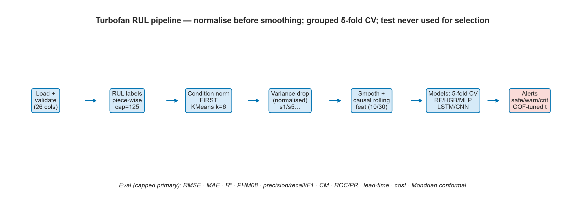
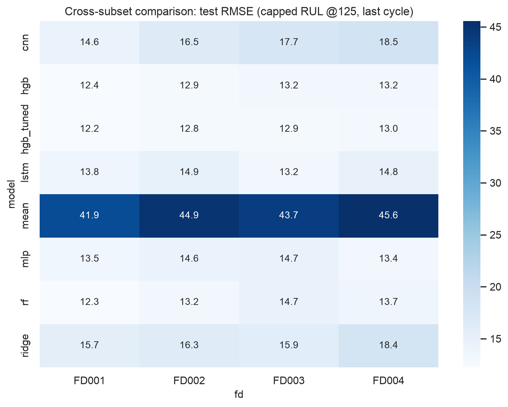
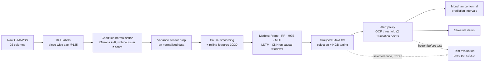
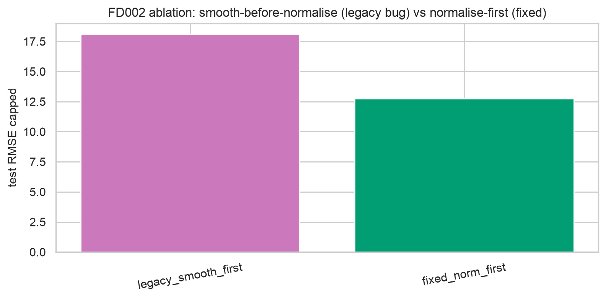

# Turbofan RUL Estimation & Maintenance Alerting (NASA C-MAPSS)

**Predict remaining useful life (RUL) from aircraft engine sensor histories — and turn it into a safe / warning / critical maintenance alert policy.** Fully reproducible end-to-end: one command regenerates every number in the report.

`Python 3.12` · `scikit-learn` · `PyTorch` · `Streamlit` · NASA C-MAPSS FD001–FD004 · [Full report (PDF)](report/report_full.pdf) · [All results](results/) (see `results/README.md` for the file map)



## Results

Model selection uses grouped 5-fold CV; the test set is only ever scored, never used for selection or threshold tuning. Primary metric: capped RUL @ 125 (standard in the C-MAPSS literature).

| Subset | CV RMSE (capped) | Test RMSE (cap @125) | MAE | PHM08 | Fails-within-30 recall\* | Median warning lead |
|---|---|---|---|---|---|---|
| FD001 | 11.61 ± 0.43 | **12.35** | 9.02 | 241 | 1.00 | 51 cycles |
| FD002 | 13.19 ± 0.32 | **12.87** | 9.27 | 737 | 1.00 | 53 cycles |
| FD003 | 9.85 ± 1.47 | **13.17** | 8.85 | 313 | 1.00 | 50 cycles |
| FD004 | 13.06 ± 1.12 | **13.17** | 8.99 | 857 | 1.00 | 50 cycles |

\* Frozen alert policy — threshold tuned on out-of-fold predictions at simulated truncation points (cost ratio 10:1), then applied once to test. The direct HGB classifier reaches 0.964–0.988 recall at 0.98–1.00 precision; the policy trades precision (0.72–0.93) for full recall.

Uncapped RMSE: 13.46 / 25.44 / 14.55 / 25.46. FD002/FD004 look worse uncapped **by construction** — 57/259 and 67/248 test engines have true RUL above the 125-cycle cap, so even a perfect capped model cannot beat ≈18 uncapped RMSE there. Both numbers are reported; capped is the headline for exactly this reason.



## Problem

Airlines still rely on fixed-interval preventive maintenance: it wastes healthy component life and still misses failures between checks. Condition-based RUL from the sensors a modern engine already streams lets maintenance be planned only when wear actually starts — the 50+ cycles of warning lead above is roughly 50 flight cycles of planning time.

Two tasks on NASA C-MAPSS run-to-failure data (FD001–FD004 span 1–6 operating conditions and 1–2 fault modes):

1. **Regression** — predict remaining useful life at the last observed cycle.
2. **Alerting** — safe (RUL > 50) / warning (20 ≤ RUL ≤ 50) / critical (RUL < 20), plus a binary "fails within 30 cycles" flag, evaluated with recall priority.

## Pipeline



## How it works — key decisions

- **Normalise before smoothing (a real bug, caught and quantified).** Smoothing raw sensors before condition normalisation blends different operating regimes and destroys the signal. It was found by inspecting feature importances (the model leaned on setpoint sensors s1/s5 — impossible carriers of damage signal), fixed, and regression-tested. As an ablation on FD002: legacy order 18.11 vs fixed 12.75 RMSE — the same fix moved FD004 from 23.87 (v1) to 13.17.

  

- **Grouped 5-fold CV everywhere; the test set is sacred.** Model selection, HGB tuning and threshold tuning run on training-grouped folds only. Thresholds are tuned on out-of-fold predictions at simulated truncation points (3 per training engine).
- **Capped RUL target.** Early in life, degradation is not observable; fitting raw RUL ≈ 200 forces noise-fitting. Cap at 125 — alert thresholds (20/30/50) sit safely below it, so labels are undistorted.
- **Cost-aware alerts with a feasibility rule.** Pick the cheapest threshold subject to OOF recall ≥ 0.95; if infeasible, fall back to the cost optimum and say so. Costs assumed 10:1 (missed failure : false alarm), with a 5/10/20/50 sensitivity table in `results/*_cost_sensitivity.csv`.
- **Uncertainty is measured, not implied.** Mondrian conformal intervals (binned on predicted RUL) with per-bin coverage; bootstrap CIs over engines for headline metrics. Slight under-coverage on FD001/FD004 is reported, not hidden.
- **Deep models get a fair shot.** LSTM/CNN on causal windows (20/30/50) with by-engine early stopping, seeds 42–44 — they still trail gradient boosting on this feature set; reported as a negative result (window-50 LSTM overfits its holdout on FD001: 10.05 → 15.72 test).

## Quickstart

```bash
git clone https://github.com/DeltaN04/rul-turbofan-Jet-Engine && cd rul-turbofan-Jet-Engine
pip install -r requirements.txt     # 1) install
python run_pipeline.py --smoke      # 2) ~2 min sanity run (fast configs)
python run_pipeline.py --fresh      # 3) full run, ~2.2 h CPU, seeds 42–44
streamlit run app.py                # 4) demo: engine history → RUL + alert
pytest tests/ -q                    # 5) 12 tests incl. leakage regression guards
```

`--fresh` recomputes everything; `--only=FD001,FD003` runs a subset; `make all` chains the full build from a clean clone (see `run_all.sh`).

## Run the Demo

```bash
# 1. Install dependencies
pip install -r requirements.txt

# 2. Ensure pipeline results exist (if not, run the pipeline first)
#    python run_pipeline.py --smoke   # quick 2-min run for demo data

# 3. Launch the Streamlit dashboard
streamlit run app.py
```

The app opens at **http://localhost:8501** with six pages (sidebar navigation):

1. **Overview** — project summary, headline metrics per subset, subset selector
2. **Engine Monitor** — select a test engine (or upload CSV), replay with cycle slider, see predicted RUL with conformal intervals, alert badge (green/amber/red), true RUL if available, and top sensor trends
3. **Fleet View** — sortable/filterable table of all test engines with predicted/true RUL and alert, plus alert-count bar chart
4. **Model Performance** — master regression/classification tables, confusion matrices, PR/ROC curves, lead-time distributions, bootstrap CIs
5. **Cost & Alert Policy** — interactive cost-ratio slider (missed failure : false alarm), OOF-optimal threshold, test cost/recall/precision
6. **About / Limitations** — simulated data caveats, validation protocol, human-in-the-loop, AI-assistance disclosure

All numbers in the app are loaded from `results/` and `models/` — no recomputation, no mock data. First load ~10–15 s (model + data cached), interactions ~1–2 s.

## Repository layout

```
run_pipeline.py        one-command pipeline (--fresh / --smoke / --only)
src/                   data · preprocess · models · train (CV/OOF) · evaluate · explain · alerts · plots
results/               every report number as CSV/JSON (+ README.md file map)
figures/               100+ colour-blind-safe, ≥200 dpi figures
models/                deployed pipelines (CV-selected HGB per subset)
report/                report.docx + report_full.pdf (54 figures, 14 tables) + verified references
slides/, viva/         13-slide deck with speaker notes · 50 examiner Q&A with this project's numbers
notebooks/             5 executed notebooks (EDA → features → models → ablations)
tests/                 pytest suite incl. leakage regression tests
app.py                 Streamlit demo (engine history → RUL + green/amber/red)
```

## Reproducibility

Everything in `results/` regenerates via `python run_pipeline.py --fresh`. Seeds are fixed; scalers, KMeans and feature selectors are fit on training folds only; causal rolling features use each engine's own past. `pytest` includes regression tests for the two leakage bugs found during development (a failure-time `cycle/max_cycle` feature — removed; the smoothing order above). Full CPU wall-clock: FD001 17.6 min · FD002 37.6 min · FD003 24.2 min · FD004 51.5 min, plus ablations.

## Honest limitations

- C-MAPSS is **simulated**: no sensor faults, drift, repairs or maintenance censoring. Numbers will not transfer to a fleet unchanged.
- Small test sets (FD001/FD003: 100 engines; 13 critical engines each) → wide CIs. FD001 direct-classifier critical recall is 0.769 (10/13) and is stated, not hidden.
- FD003's conformal intervals over-cover but are wide (~86 cycles half-width) — honest, but of limited operational value there.
- The 10:1 cost ratio is an assumption, not airline data.
- XGBoost/LightGBM wheels need system `libomp`; scikit-learn `HistGradientBoosting` stands in as the boosting representative (documented in the report).

## Future work

Transformers/temporal attention under the same grouped protocol; domain adaptation with drift monitoring; survival-analysis heads; quantile/adaptive conformal; sensor-fault robustness for edge deployment.

## Data

NASA Prognostics Center of Excellence C-MAPSS dataset (Saxena, Goebel, Simon, Eklund — PHM 2008), included under `data/raw/`. All credit for the benchmark belongs to its authors; this is an independent educational reimplementation.

## License

MIT — see [LICENSE](LICENSE).
